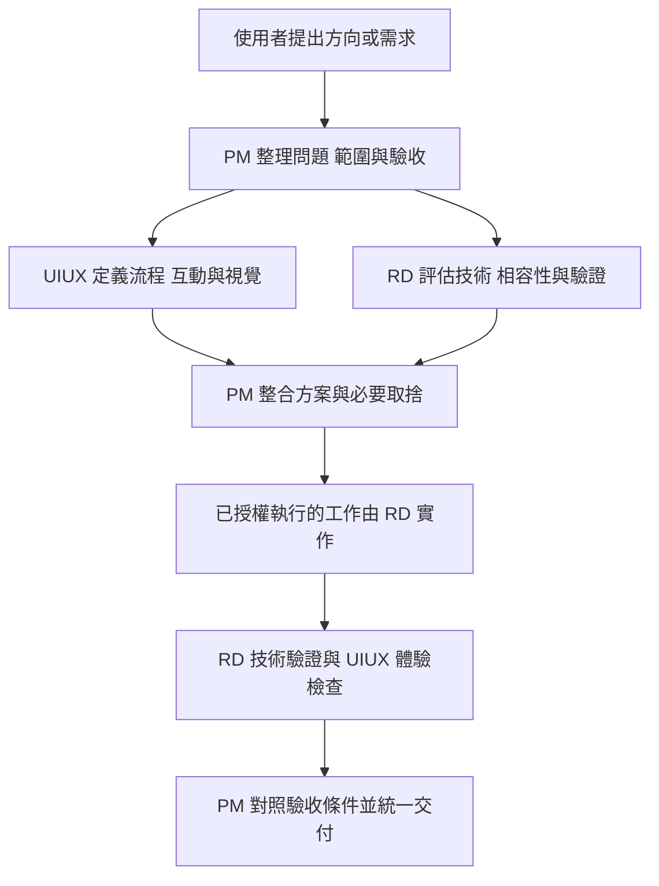

# 瓶中森 PM RD UIUX 協作方式

使用者主要與 PM 討論產品走向與需求。主對話由協調者以 PM 身分承接，再依工作內容委派 RD 與 UIUX，最後統一說明決策、進度與成果。使用者不需要自己維護三條對話或搬運交接內容。

## 角色分工

| 角色 | 主要責任 | 交付內容 | 不自行決定的事項 |
| --- | --- | --- | --- |
| PM | 玩家問題、產品方向、範圍、優先順序、需求與驗收、跨角色協調 | 需求摘要、取捨建議、驗收條件、整合結果 | 未被授權的新功能與產品方向、未評估的期限承諾 |
| RD | 技術方案、實作、相容性、測試與缺陷修正 | 可執行變更、必要測試、技術風險與驗證結果 | 額外的產品範圍、擅自更改互動目標 |
| UIUX | 使用流程、資訊層級、狀態與文案、視覺與無障礙 | 可實作的設計規則、流程與狀態、體驗驗收結果 | 未經需求支持的整體改版或新功能排程 |

主協調者預設承擔 PM 的日常溝通；獨立 `pm` agent 可用於較複雜的需求分析或產品審查。一般工程需求可由主協調者直接協調 `rd` 與 `uiux`，不為了角色數量而重複分析。

## 你可以怎麼提出需求

直接描述想達成的效果即可，例如：

- 「我希望玩家不用一直照顧，也能偶爾回來看看。」
- 「讓小兔更有個性，先討論有哪些做法。」
- 「手機版看不清楚，幫我改善。」
- 「這個方案可以，開始開發。」

PM 會整理玩家情境、本次改變、範圍與完成條件。若資訊已足夠就繼續；只有重要取捨才提出簡短問題。也可以直接說「這題請 RD 解釋」或「請 UIUX 提兩個方案」，但交接與整合仍由主對話處理。

## 從想法到交付



這是責任順序，不是每次都要完成一整套文件或簽核。明確的小修改可把需求摘要直接寫在任務訊息內；複雜功能才建立獨立需求文件。只要求討論或規劃時，工作停在該次要求的分析產出，不自行開發。

### 需求紀錄

需要保存的需求放在 `docs/requirements/`，由 PM 指派名稱與編輯者。以下是可精簡的紀錄格式，不要求使用者填寫：

```markdown
# 需求名稱

## 狀態
討論中／待釐清／待實作／實作中／待驗證／已完成

## 玩家問題與目標
誰在什麼情境遇到什麼問題，希望產生什麼改善。

## 本次範圍
這次處理的行為、必要限制與明確排除的內容。

## 驗收條件
列出可觀察、可重現的預期行為。

## 方案與決策
使用者已決定事項、尚未決定的取捨、暫採假設分開記錄。

## 交接
RD 與 UIUX 各自的目標、檔案責任與交付證據。

## 驗證與結果
已執行的檢查、未驗證項目、實際交付範圍及 Git／發布狀態。
```

「待實作」只用於已有執行授權的工作；agent 自行提出的建議留在討論中，不代表已列入開發排程。若遇到真正阻礙，記錄阻礙、影響與可獨立推進的部分。

### RD 與 UIUX 的交接

1. UIUX 定義使用流程、適用的互動狀態、文案、桌機與手機差異及驗收方式。
2. RD 回報技術可行性、會改動的模組、存檔或資料影響，以及必要的驗證。
3. 相互依賴的決定由 PM 合併成同一份需求，避免兩套互相矛盾的方案。
4. 正式 UI 程式預設由 RD 修改；UIUX 編輯設計文件或獨立原型。若要平行實作，先明確分配互不重疊的檔案。
5. 實作後由 RD 提供技術證據，UIUX 檢查相應體驗，PM 對照完成條件並回報使用者。

## 協作與發布原則

- 同一任務已有的有效授權不重複詢問。產品方向不明確時，PM 彙整必要問題，不讓三個角色各自打斷使用者。
- 所有角色先檢查分支、worktree 與未提交檔案，保留前一項工作的成果。
- 分派時指定讀寫範圍；同一檔案只能有一位同時編輯的負責者。
- 功能開發優先隔離在分支／worktree。尚未提交的需求文件不會自動跟到新 checkout，交接時要確認可存取的實際路徑。
- 明確區分「程式完成」「自動化測試通過」「瀏覽器已驗證」「已合併」「已推送」「已發布」。
- 日常 commit 與功能分支 push 採下列已同意的節奏；主線發布依使用者授權的時機執行，也不因有多角色就增加例行簽核。
- 規格書描述已實作的行為，需求文件描述計畫中的變更。功能交付後再把結果回寫到規格。

### 已同意的 commit 與 push 節奏

2026-11-04 使用者同意由 RD 按需求與進度執行日常提交，PM 統一協調驗收及發布時機。

| 時機 | 負責角色 | 行為 |
| --- | --- | --- |
| 一個可驗證的小功能、修正或文件單元完成 | RD | 相關檢查通過後 commit，訊息對應實際目的 |
| 一個階段的成果完成 | RD | Push 該任務的非 `main` 分支，保留備份與審查紀錄 |
| 需求驗收完成 | PM | 整合 RD 的驗證；介面變更另納入 UIUX 檢查，安排主線合併 |
| 到達使用者授權的發布時機 | PM 協調 RD | Push `main`，追蹤自動測試、部署與線上版本驗證 |

前兩項是持續有效的工作約定，不需要使用者逐次下達 commit／push 指令。當次若要求只討論、只規劃、暫不提交或暫不推送，則以該次範圍為準。

提交前確認分支、差異與驗證結果，只納入負責的檔案或變更區塊；不把其他工作混進來。階段性推送不代表已完成全部需求，也不代表已發布。不得自行 force push、改寫共享歷史、刪除遠端分支或繞過保護規則。

目前 push `main` 會觸發 GitHub Pages 部署，因此非主線分支的日常推送許可不包含主線發布。已有涵蓋該版本的發布授權時直接執行，不重複確認；尚無發布安排時，PM 回報待發布成果與狀態。

交付摘要記錄分支、commit、已執行驗證、遠端同步結果及發布狀態，讓使用者只需和 PM 決定方向與發布節奏。

## 驗證標準

| 變更 | RD 證據 | UIUX 與 PM 檢查 |
| --- | --- | --- |
| 生態邏輯或數值 | 語法檢查、既有測試、必要的邊界與長時間演算測試 | 實際玩法是否符合需求、提示是否與規則一致 |
| 操作或畫面 | 語法檢查、相關測試、投影及存檔影響 | 玩家流程、各種狀態、觸控、鍵盤、窄版、減少動態 |
| 存檔或資料格式 | 有效舊存檔、無效資料、相容或遷移測試 | 玩家進度與錯誤提示是否符合預期 |
| 純文件或角色設定 | 內容與連結、設定語法、差異檢查 | 需求是否準確、分工是否清楚 |

無法取得瀏覽器或裝置時，具體記錄哪些檢查未做；不把 Node 測試或離線圖片說成實機驗收通過。這是證據要求，不是一律停止開發的簽核條件。

需要記錄體驗驗收時，附上對應需求或驗收條件、環境、操作步驟、證據位置，以及通過／未通過／未驗證的結果，方便 PM 整合；小任務可用簡短文字記錄。

## 專案現況與初次盤點

2026-11-04 已讓 PM、RD、UIUX 三個角色分別讀取現有規格與相關檔案，完成首次盤點。

- **產品基準**：2.5D 療癒像素生態瓶，玩家透過放置、環境調整、觀察與照顧形成循環；無勝負、貨幣或離線進度。
- **技術基準**：原生 JavaScript、Canvas 2D、Web Audio、localStorage v1，正式網站在 `dist/`；2.5D 已合併至主線並發布。
- **視覺基準**：米白、森林綠、像素圖像與自然語氣；變更需先對應玩家問題。
- **驗證現況**：已記錄 27 項程式測試通過與離線繪圖檢查；完整瀏覽器、手機、觸控、音訊與下載實測仍有缺口。此次導入角色未重跑遊戲測試。

PM 首次提出的可討論方向是「照顧頻率」「佈置與個人表達」「居民陪伴與長期發現」。這些只是討論選項，沒有建立新功能任務或承諾排程。

UIUX 首次建議優先驗證新手放置與觀察、手機小字與對比、鍵盤焦點及觸控操作。這些也不是已完成的實測結果。

## 設定位置與使用方式

| 檔案 | 用途 |
| --- | --- |
| [AGENTS.md](../AGENTS.md) | 專案的預設 PM 對口、委派、整合與驗證規則 |
| [pm.toml](../.codex/agents/pm.toml) | PM 自訂 agent 定義 |
| [rd.toml](../.codex/agents/rd.toml) | RD 自訂 agent 定義 |
| [uiux.toml](../.codex/agents/uiux.toml) | UIUX 自訂 agent 定義 |
| [GAME_SPEC.md](GAME_SPEC.md) | 現行遊戲規格與邏輯基準 |

角色檔採官方的專案自訂 agent 格式，放在 `.codex/agents/`，每份指定 `name`、`description` 與 `developer_instructions`。不覆寫模型、推理強度、工具權限或全域設定，沿用主工作階段的設定。[官方自訂 agent 說明](https://learn.chatgpt.com/docs/agent-configuration/subagents)

專案規則放在根目錄 `AGENTS.md`。後續從 `pixel-terrarium` 專案內開啟支援此格式的新工作階段時載入；現有對話不能只靠新檔案就假設設定已自動熱更新。[官方 AGENTS.md 說明](https://learn.chatgpt.com/docs/agent-configuration/agents-md)

本次會話的三個角色由協作工具明確啟動並讀取對應角色檔。它們完成工作後可續接或依需要重建，不代表三個永久在線的聊天機器人，也沒有另建需要帳號或 API 金鑰的服務。
